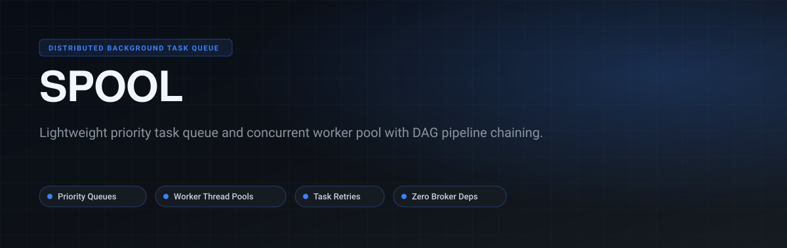
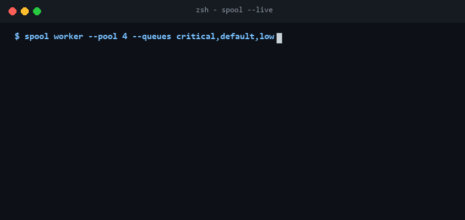

<p align="center">
  
</p>

<p align="center">
  <a href="https://github.com/Gaurav28-tech/spool/actions"></a>
  <a href="LICENSE"></a>
  
  
</p>

<p align="center">
  <b>Spool</b> is a lightweight background job queue and worker execution framework for Python. Designed as a clean, low-overhead alternative to Celery, it provides priority-ranked scheduling, worker concurrency control, task timeouts, retry backoff, and linear/DAG pipeline chaining.
</p>

---

## ⚡ Live Terminal Preview

<p align="center">
  
</p>

---

## 🚀 Key Capabilities

- **Priority Scheduling**: Strict priority ordering (`CRITICAL` > `HIGH` > `DEFAULT` > `LOW`) ensuring vital workloads preempt background jobs.
- **Worker Pools**: Configurable thread worker pools with graceful shutdown and signal handling.
- **Pipeline & DAG Chaining**: Express task dependencies easily; downstream jobs trigger automatically upon successful upstream completion.
- **Failure Resilience**: Built-in timeout enforcement, failure recovery, and configurable retry counts.
- **Zero External Dependencies**: Pure Python standard library implementation with zero Redis/RabbitMQ infrastructure overhead.

---

## 🏗️ Architecture

<p align="center">
  
</p>

---

## 📦 Quickstart

### Installation

```bash
git clone https://github.com/Gaurav28-tech/spool.git
cd spool
```

### Basic Usage

```python
from taskcraft.queue import PriorityTaskQueue
from taskcraft.worker import WorkerPool
from taskcraft.models import TaskPriority
import time

queue = PriorityTaskQueue()

def generate_invoice(order_id: str):
    time.sleep(0.1)
    return f"invoice_{order_id}.pdf"

# Enqueue task with priority
task_id = queue.enqueue(
    func=generate_invoice,
    args=("ord_8819",),
    priority=TaskPriority.HIGH
)

# Start workers to process jobs
pool = WorkerPool(queue, num_workers=2)
pool.start()

result = pool.wait_for(task_id, timeout=2.0)
print(f"Task Status: {result.state.value}, Output: {result.result}")
pool.stop()
```

### Running Test Suite

```bash
python -m unittest discover -s tests -p "test_*.py"
```

---

## 📄 License

Distributed under the [MIT License](LICENSE).
